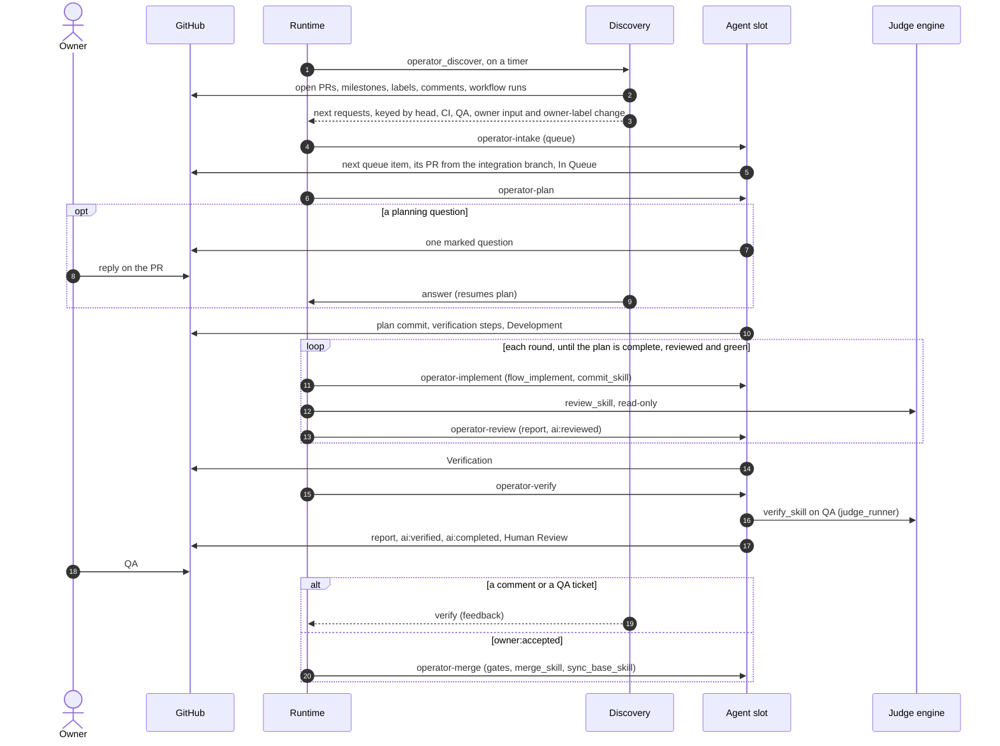

# Development pack

Phase skills for the operator runtime (`@ainova-systems/operator`). The runtime is generic: it runs
the operations a project's `operator.yaml` declares, on timers and triggers, and holds pools, jobs
and waits. This pack is what those operations run. Each phase skill owns *when* a pull request
moves and *who* holds it, and hands the work of each step to the skill a profile key names
(`operator-contract` > Delegated steps): capturing criteria, committing, opening the pull request,
review, verification, review threads, the outcome, merging and returning a slot to the integration
branch, plus profile `flow_implement` for the implementation itself.

## Core: recommended, optional via profile keys

For a clean start install the core pack beside this one: every delegated-step key defaults to a
core skill, and core's `git-workflow` rule states the same label, factor and report vocabulary.
A project that already has its own equivalents points the keys at them instead. What a replacement
must honour is the contract this pack owns - the state labels and their single writer, the
success factors and their freshness at head (the verification steps and review body digests included), the stage
report envelope and the claim (`operator-contract` > `references/pr-state.md`, which wins for operator
runs when both packs are installed) - and the duty each key's row in the Delegated steps table names.

Without the runtime the same flow runs by hand, with neither `operator` nor herdr (an optional
terminal multiplexer the runtime can place its runs in): profile
`operator_discover --standalone` names the next skill for each PR, and each skill runs from a
session (`operator-contract` > Run by hand). `dev-deliver-next` (core, when installed) delivers a
queue item in one session instead of phase by phase.

## Skills

| Skill | Milestone role (default title) | Leaves when |
|---|---|---|
| `operator-contract` | - | the run contract every phase skill loads first |
| `operator-intake` | the work queue, or a handed-off pull request → `queue` (In Queue) | a queue item has its pull request, or the handed-off one sits in a slot |
| `operator-plan` | `queue` (In Queue) | the plan and its verification steps are committed |
| `operator-implement` | `development` (Development) | the plan is complete, the head is reviewed and CI is green |
| `operator-review` | `development` (Development) | the runtime's review is posted (runtime only) |
| `operator-verify` | `verification` (Verification) | profile `verify_skill` passed and profile `outcome_skill` wrote `ai:completed` |
| - (the owner) | `humanReview` (Human Review) | feedback returns it to Verification; `owner:accepted` sends it to merge |
| `operator-merge` | `mergeQueue` (Merge Queue) | merged |

## Profile keys

Every profile key the skills read, its default and its meaning is defined once in
[`templates/operator-project-profile.md`](templates/operator-project-profile.md): the operator's own
keys, the delegated-step skills, and the keys it shares with the core pack's profile schema (same
default and meaning, stated there so the pack runs without core). A project adds the keys it sets to
its project profile; a key left out takes its default.

## The flow

## Clarification

Queue items waiting on an owner decision are settled by the separate clarification pack
(`@ainova-systems/operator-clarification`), which builds on this pack's contract.

## What the owner does

- **Hands a pull request to the pipeline** with the `operator_config` `labels.handoff` label: the
  next free slot adopts it ahead of every queue item, plan revises its scope from what it already
  carries, and it follows the regular flow from there.
- **Answers questions** in the PR conversation; discovery resumes the asking skill.
- **Answers a spent round budget**: a pull request whose rounds ran out carries `ai:manual` and an
  `## Outcome - MANUAL` report; a comment after it sends it back to implementation with a new budget
  (profile `max_pr_rounds`).
- **Tests on QA** in Human Review; a comment or a QA ticket sends the PR back.
- **Steers with labels**: `owner:accepted`, `owner:onhold`, `owner:revalidate`, `owner:rejected`,
  `owner:cancelled` (`operator-contract` > Owner labels); `owner:question` marks a pull request
  that waits on an owner's answer (`operator-contract` > Asking the owner).
